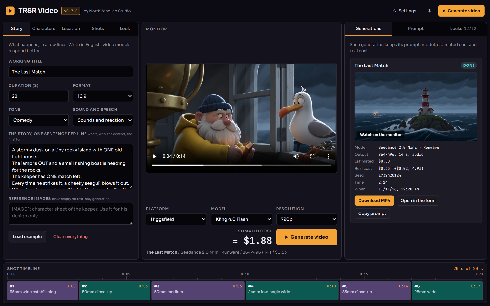
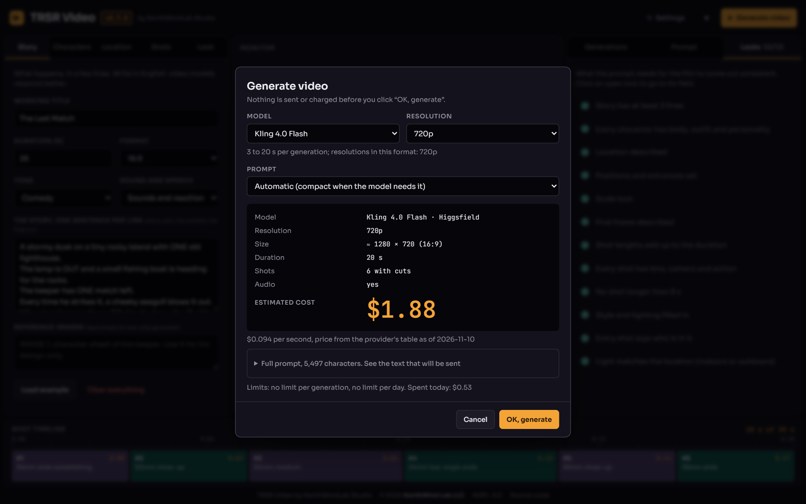
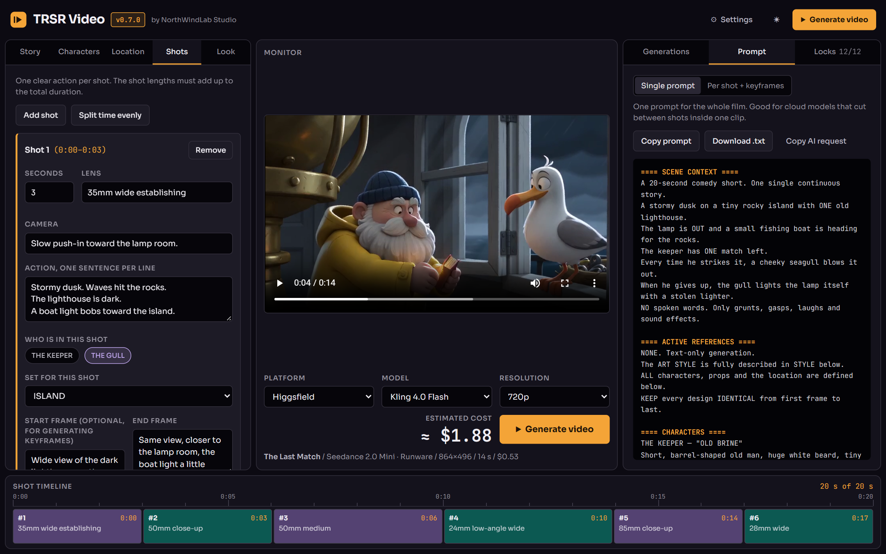
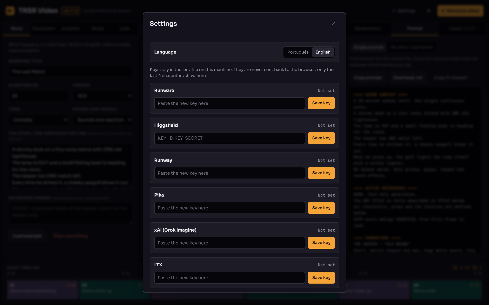

# TRSR Video

**English** | [Português](README.pt-BR.md)

AI video studio by NorthWindLab Studio, the studio brand of **NorthWind Lab LLC**. You build the film (story, characters, location, shots, look), pick the platform and the model, see the cost, confirm, and get the video. You can also just copy the prompt and generate somewhere else. AGPL-3.0 license.

## Screenshots



The studio. Project on the left, monitor with the platform, model and resolution picker in the middle, generations on the right, shot timeline at the bottom.



The confirmation window. Nothing is sent or charged before you click "OK, generate".



Shots and the prompt that goes to the model.



Settings: language (Portuguese or English) and one key per platform. Keys stay in the local `.env`.

## Current state

Working: the prompt builder (full, compact and per shot), the local server with keys in `.env`, the model registry, nine platforms, cost estimate, confirmation window, a queue that runs one request at a time, MP4 download, the list of generations with a monitor, a key test, images and music made on this computer through ComfyUI, reference images made in the cloud, and films in parts with the same characters.

Not done yet: a library with filters and side-by-side comparison, an agent that fills the form from a free-text request, Leonardo.

The adapters were written from each platform's documentation and are covered by tests with simulated answers. Against the real APIs so far: the key test (Runware, Higgsfield and Krea) and one generation on Runware (Seedance 2.0 Mini). On the other platforms, the first generation is the real test.

The interface is available in Portuguese and English (PT / EN switch in the top bar). The prompt sent to the model is always in English.

## Run it

Requires Node 20 or newer.

```
npm install
npm start            # builds the interface and starts the server at http://127.0.0.1:4477
```

On Windows, `start.bat` does both.

Keys are saved on the **Settings** screen, which writes the `.env` file, or directly in `.env` starting from `.env.example`. A key stays on the server: the browser only receives its last 4 characters, and it never goes into logs or the history. **Test key** makes one read-only call to the provider and generates nothing.

The server listens on `127.0.0.1` only. Publishing it on a server needs a login in front of it first: anyone who reaches the port can spend the credit.

To work on the interface: `npm run server` in one terminal and `npm run dev` in another (http://localhost:5173).

## What happens when you generate

1. Below the monitor you choose **Platform**, **Model** and **Resolution**; the estimated cost shows next to them.
2. If the shots do not add up to the duration, or the duration does not fit the model, one button fits the shots, keeping how many there are and their proportions.
3. **Generate video** opens the window with model, size, duration, audio, estimated cost (with the date of the price) and the exact prompt text.
4. Only **OK, generate** sends anything. The server refuses requests without the confirmation or with an amount different from the one shown.
5. Requests run one at a time. A refused key or a lack of balance stops the queue; nothing is retried in a loop.
6. The MP4 is downloaded to `data/videos` and shows on the monitor. When the provider reports the real cost, it is shown next to the estimate.

## Platforms

| Platform | Models in the registry | Cancel | Reports real cost |
|---|---|---|---|
| Runware | Seedance 2.0 Mini, Seedance 2.5, Kling 4.0 Flash | no | yes |
| Higgsfield | Seedance 2.5, Kling 4.0 Flash | only while queued | no |
| Runway | Gen-4.5, Seedance 2.5 | yes | no |
| Pika | Pika 2.5 | no | yes |
| xAI | Grok Imagine Video 1.5, 1.5 Lite and classic | no | no |
| LTX | LTX-2.3 and LTX-2.5, Fast and Pro | no | no |
| Kling | Kling 4.0 Flash, Kling 4.0 | no | no |
| Google | Gemini Omni 1.1 Flash (the model picks the duration) | no | no |
| Krea | Veo 3.1; Seedance listed, price not verified | yes | no |

## Images on this computer

The **Media** tab has two parts, Images and Music. Images makes the still images of the film on your own machine, through [ComfyUI](https://github.com/comfyanonymous/ComfyUI), at no cost: one reference per character, one empty plate per set, and the first and last frame of each shot. The text of each image is the same text the "per shot + keyframes" prompt shows.

TRSR Video asks ComfyUI which model files it has and offers only the models that are complete:

| Model | Used for | Files (any precision) |
| --- | --- | --- |
| Z-Image Turbo | characters and sets, 8 steps | `diffusion_models/z_image_turbo*`, `text_encoders/qwen_3_4b*`, `vae/ae.safetensors` |
| MOSS-Image | characters and sets, 25 steps | `diffusion_models/moss_image*`, `text_encoders/qwen3.5_9b*`, `vae/flux2-vae*` |
| Qwen-Image-Edit 2511 | shot frames, from the set plate plus up to 2 character references | `diffusion_models/qwen_image_edit_2511*`, `text_encoders/qwen_2.5_vl_7b*`, `vae/qwen_image_vae*`, optional `loras/Qwen-Image-Edit-2511-Lightning-4steps*` (4 steps instead of 40) |

The graphs are the ones of ComfyUI's own workflow templates for each model. ComfyUI is expected at `http://127.0.0.1:8188`; set `COMFYUI_URL` in `.env` if it runs somewhere else. Images are kept in `data/images`. One image is made at a time and nothing is sent again on its own. A shot with 3 or more characters is not generated yet. Each model's own license applies to what it makes.

The images are not sent to the video platforms yet: today they are for checking the look, and for first/last-frame workflows outside the app.

## Films longer than one generation

A model makes a limited number of seconds at a time (15 on some, 20 or 30 on others). When the film is longer than that, TRSR Video splits it into parts, always between two shots, and sends one generation per part.

- **Same characters in every part.** Pick the reference images of the film (characters and sets from the Media tab) and they go with every part, on the models that accept reference images.
- **One confirmation.** The window shows every part, its prompt and the total, before anything is sent.
- **If a part fails,** the parts still waiting are canceled and nothing else is charged. Generating again resumes the film: finished parts are kept.
- **Joined at the end.** With FFmpeg on the computer, the parts become one MP4.

## Images in the cloud

No ComfyUI? The model list in Media > Images also offers cloud models (`registry/images.json`), made with the key of the platform you already saved. Today: Z-Image Turbo on Runware, for character references and empty sets. A cloud image costs money, so the app shows how many images and about how much, and waits for your OK; the real cost appears on each image. First and last frames of a shot still need an editing model on this computer.

## Music

In the **Media** tab, Music gives the film a soundtrack in two ways:

- **Generate** it on this computer with Stable Audio 3 Medium through ComfyUI, at no cost. The description follows the tone of the film (comedy, heartfelt, suspense, action, wonder), the length is the length of the film, and it is always instrumental. You can rewrite the description before generating. Files: `checkpoints/stable_audio_3_medium*` and `text_encoders/t5gemma_b_b_ul2*`.
- **Add** a file of your own (mp3, wav, flac, ogg, m4a or aac, up to 40 MB).

The track marked "in use" plays together with the video on the monitor. "Download MP4 with music" puts it under the video's own sound with [ffmpeg](https://ffmpeg.org) on this computer: the picture is copied untouched, the music fades out at the end, and the original MP4 stays as it is. Set `FFMPEG_PATH` in `.env` if ffmpeg is not on the PATH. You are responsible for the rights of the music you add; the model's own license applies to what it makes.

## Models and prices

`registry/models/*.json` has one entry per model: duration, sizes by resolution and format, price per second, prompt limit, whether it cuts between shots in one generation. `null` means "not checked against the documentation": the app does not offer that option. `pricing.source` says whether the price comes from the provider's table (`official`) or from a real generation (`measured`), and `asOf` is the date. Prices change: check before you rely on them.

To add a model on a platform that already exists, add one entry. For a new platform: one entry in `registry/providers.json`, one file in `packages/server/src/providers/` with `submit`, `poll` and, if the provider allows it, `cancel`, one line in `providers/check.ts` for the key test, and the adapter registered in `main.ts`.

## The three prompts

- **Full:** 19 sections, from SCENE CONTEXT to FINAL POSITIVE LOCKS. Sent to models that cut between shots in one generation and have room for it.
- **Compact:** the same film in about half the text. Sent automatically to models with a short prompt limit or that make a single clip; for those, the shots become one continuous action.
- **Per shot + keyframes:** character references, empty sets, a start and an end frame, and a short prompt per shot, for local first-and-last-frame workflows. Copy only.

## Tests

```
npm test             # unit tests; provider tests use simulated answers and spend no credit
npm run typecheck
```

`packages/core/test/golden` holds what the original v2.2 page produced for each sample state. The full and the per-shot prompts must stay identical to those files; a change to the text has to be intentional.

## Folders

```
packages/core/src/
  presets.ts            tones, sound and speech, styles, lights
  state.ts              shape of the state, blank(), example()
  prompt/single.ts      full prompt
  prompt/compact.ts     compact prompt and the automatic choice
  prompt/perShot.ts     per shot + keyframes
  checks.ts             the 12 locks
  models.ts             size, validation per model, shot rescaling, cost
packages/server/src/
  env.ts                reads and writes .env
  registry.ts           loads registry/
  providers/            one file per platform, check.ts (key test), http.ts
  jobs.ts               queue, polling, download, history in data/jobs.json
  app.ts                /api routes
packages/web/
  index.html            the studio screen
  src/main.js           form, timeline, prompt
  src/generate.js       platform and model, generate, settings, generations, monitor
  src/ui.js             tabs, theme, version
registry/               providers.json and models/*.json
legacy/                 the original v2.2 page, reference for the goldens
data/                   not in git: jobs.json and videos/
```

## Contributing

Issues and pull requests are welcome. Run `npm test` and `npm run typecheck` before sending. For a new model or platform, link the documentation page each value came from in the registry entry (`docsUrl`), and leave `null` for anything you could not verify.

## License and credit

GNU Affero General Public License, version 3, see [LICENSE](LICENSE), with the additional terms in [NOTICE](NOTICE).

- You can use, study, change and share TRSR Video.
- If you share it, a modified version of it, or run a modified version as a service for other people, you must publish your source code under the same license.
- Every copy and every modified version must keep a visible credit in the interface and in the documentation, linked to [northwindlab.com](https://northwindlab.com): "TRSR Video by NorthWindLab Studio" for unmodified copies, "Based on TRSR Video by NorthWindLab Studio" for modified ones.
- "TRSR Video" and "NorthWindLab" are marks of NorthWind Lab LLC. A modified version needs its own name and logo.

---

© 2026 **NorthWind Lab LLC** · [northwindlab.com](https://northwindlab.com) · contact@northwindlab.com
