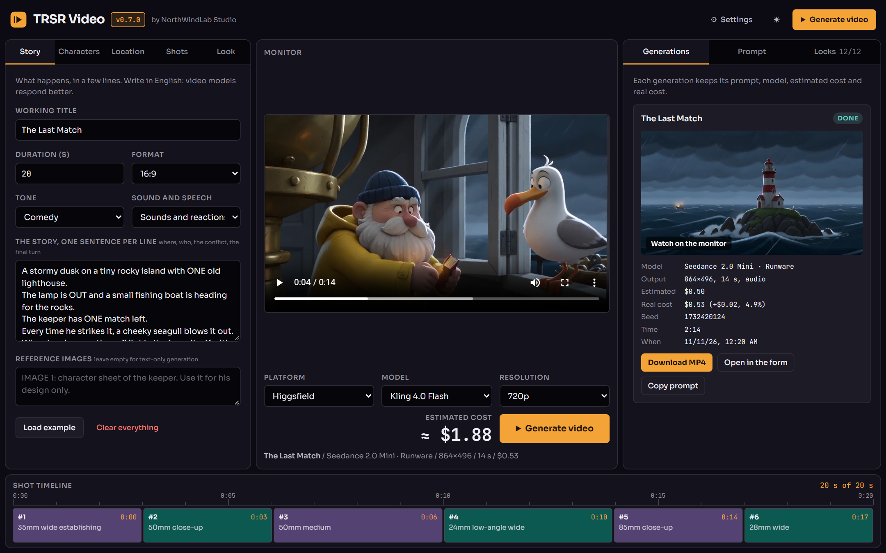
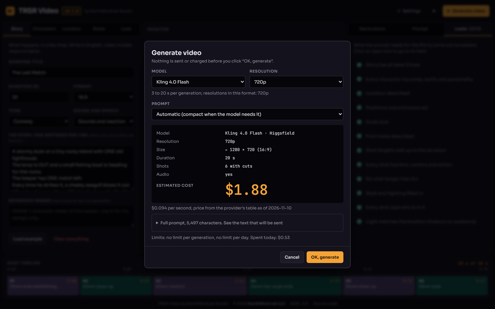
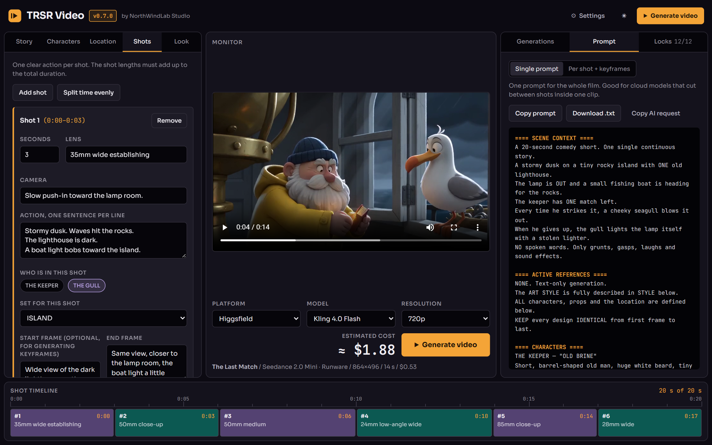
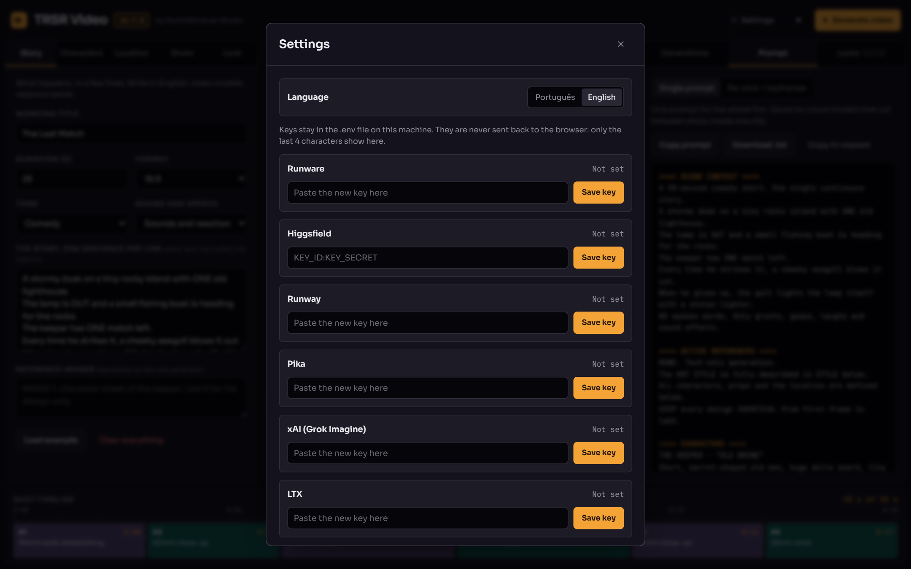

# TRSR Video

[English](README.md) | **Português**

Estúdio de vídeo com IA da NorthWindLab Studio, a marca de estúdio da **NorthWind Lab LLC**. Você monta o filme (história, personagens, cenário, tomadas, visual), escolhe a plataforma e o modelo, vê o custo, confirma e recebe o vídeo. Também dá para só copiar o prompt e gerar em outro lugar. Licença AGPL-3.0.

## Telas



O estúdio. Projeto à esquerda, monitor com a escolha de plataforma, modelo e resolução no meio, gerações à direita, linha do tempo das tomadas embaixo. As imagens mostram a interface em inglês; o português fica em Configurações.



A janela de confirmação. Nada é enviado nem cobrado antes do "OK, gerar".



As tomadas e o prompt que vai para o modelo.



Configurações: idioma e uma chave por plataforma. As chaves ficam no `.env` local.

## Estado atual

Funciona: o montador de prompt (completo, compacto e por tomada), o servidor local com as chaves no `.env`, o registro de modelos, nove plataformas, estimativa de custo, janela de confirmação, fila de um pedido por vez, download do MP4, lista de gerações com monitor, teste de chave, e imagens e música feitas neste computador pelo ComfyUI.

Ainda não foi feito: biblioteca com filtros e comparação lado a lado, agente que preenche o formulário a partir de um pedido livre, Leonardo.

Os adaptadores foram escritos a partir da documentação de cada plataforma e são cobertos por testes com respostas simuladas. Contra as APIs reais até agora: o teste de chave (Runware, Higgsfield e Krea) e uma geração na Runware (Seedance 2.0 Mini). Nas outras plataformas, a primeira geração é o teste de verdade.

## Usar

Requer Node 20 ou mais novo.

```
npm install
npm start            # monta a interface e abre o servidor em http://127.0.0.1:4477
```

No Windows, `start.bat` faz as duas coisas.

As chaves são salvas na tela **Configurações**, que grava o arquivo `.env`, ou direto no `.env` a partir do `.env.example`. A chave fica só no servidor: o navegador recebe apenas os 4 últimos caracteres, e ela não entra em logs nem no histórico. **Testar chave** faz uma consulta de leitura ao provedor, sem gerar nada.

O servidor escuta só em `127.0.0.1`. Publicar num servidor exige um login na frente: quem alcança a porta gasta o crédito.

Para desenvolver a interface: `npm run server` num terminal e `npm run dev` em outro (http://localhost:5173).

## O que acontece ao gerar

1. Abaixo do monitor você escolhe **Plataforma**, **Modelo** e **Resolução**; o custo estimado aparece ao lado.
2. Se a soma das tomadas não bate com a duração, ou a duração não cabe no modelo, um botão ajusta as tomadas mantendo a quantidade e as proporções.
3. **Gerar vídeo** abre a janela com modelo, tamanho, duração, áudio, custo estimado (com a data do preço) e o texto exato do prompt.
4. Só o **OK, gerar** envia. O servidor recusa pedidos sem a confirmação ou com um valor diferente do que foi mostrado.
5. Os pedidos rodam um de cada vez. Chave recusada ou falta de saldo param a fila, sem tentar de novo.
6. O MP4 é baixado para `data/videos` e aparece no monitor. Quando o provedor informa o custo real, ele fica ao lado do estimado.

## Plataformas

| Plataforma | Modelos no registro | Cancela | Informa custo real |
|---|---|---|---|
| Runware | Seedance 2.0 Mini, Seedance 2.5, Kling 4.0 Flash | não | sim |
| Higgsfield | Seedance 2.5, Kling 4.0 Flash | só na fila | não |
| Runway | Gen-4.5, Seedance 2.5 | sim | não |
| Pika | Pika 2.5 | não | sim |
| xAI | Grok Imagine Video 1.5, 1.5 Lite e clássico | não | não |
| LTX | LTX-2.3 e LTX-2.5, Fast e Pro | não | não |
| Kling | Kling 4.0 Flash, Kling 4.0 | não | não |
| Google | Gemini Omni 1.1 Flash (o modelo decide a duração) | não | não |
| Krea | Veo 3.1; Seedance listado, sem preço conferido | sim | não |

## Imagens neste computador

A aba **Mídia** tem duas partes, Imagens e Música. Imagens faz as imagens paradas do filme na sua própria máquina, pelo [ComfyUI](https://github.com/comfyanonymous/ComfyUI), sem custo: a referência de cada personagem, cada cenário vazio e o primeiro e o último quadro de cada tomada. O texto de cada imagem é o mesmo que o prompt "por tomada + keyframes" mostra.

O TRSR Video pergunta ao ComfyUI quais arquivos de modelo ele tem e só oferece os modelos completos:

| Modelo | Uso | Arquivos (qualquer precisão) |
| --- | --- | --- |
| Z-Image Turbo | personagens e cenários, 8 passos | `diffusion_models/z_image_turbo*`, `text_encoders/qwen_3_4b*`, `vae/ae.safetensors` |
| MOSS-Image | personagens e cenários, 25 passos | `diffusion_models/moss_image*`, `text_encoders/qwen3.5_9b*`, `vae/flux2-vae*` |
| Qwen-Image-Edit 2511 | quadros das tomadas, a partir do cenário e de até 2 referências de personagem | `diffusion_models/qwen_image_edit_2511*`, `text_encoders/qwen_2.5_vl_7b*`, `vae/qwen_image_vae*`, opcional `loras/Qwen-Image-Edit-2511-Lightning-4steps*` (4 passos em vez de 40) |

Os grafos são os dos modelos de fluxo do próprio ComfyUI para cada modelo. O ComfyUI é esperado em `http://127.0.0.1:8188`; ponha `COMFYUI_URL` no `.env` se ele roda em outro endereço. As imagens ficam em `data/images`. Uma imagem é feita por vez e nada é reenviado sozinho. Tomada com 3 ou mais personagens ainda não é gerada. A licença de cada modelo vale para o que ele gera.

As imagens ainda não são enviadas às plataformas de vídeo: hoje servem para conferir o visual e para fluxos de primeiro/último quadro fora do app.

## Filmes maiores que uma geração

Um modelo faz um número limitado de segundos por vez (15 em alguns, 20 ou 30 em outros). Quando o filme é maior que isso, o TRSR Video divide em partes, sempre entre duas tomadas, e envia uma geração por parte.

- **Os mesmos personagens em todas as partes.** Escolha as imagens de referência do filme (personagens e cenários da aba Mídia) e elas vão junto com cada parte, nos modelos que aceitam imagens de referência.
- **Uma confirmação só.** A janela mostra cada parte, o prompt e o total antes de enviar qualquer coisa.
- **Se uma parte falhar,** as partes que ainda esperavam são canceladas e nada mais é cobrado. Gerar de novo retoma o filme: as partes prontas são mantidas.
- **Juntado no final.** Com o FFmpeg no computador, as partes viram um MP4 só.

## Imagens na nuvem

Sem ComfyUI? A lista de modelos em Mídia > Imagens também oferece modelos na nuvem (`registry/images.json`), feitos com a chave da plataforma que você já salvou. Hoje: Z-Image Turbo na Runware, para referências de personagem e cenários vazios. Imagem na nuvem custa dinheiro, então o app mostra quantas imagens e cerca de quanto, e espera o seu OK; o custo real aparece em cada imagem. O primeiro e o último quadro de uma tomada ainda precisam de um modelo de edição neste computador.

## Música

Na aba **Mídia**, Música dá uma trilha ao filme de dois jeitos:

- **Gerar** neste computador com o Stable Audio 3 Medium pelo ComfyUI, sem custo. A descrição segue o tom do filme (comédia, emotivo, suspense, ação, encantamento), a duração é a do filme e a música é sempre instrumental. Dá para reescrever a descrição antes de gerar. Arquivos: `checkpoints/stable_audio_3_medium*` e `text_encoders/t5gemma_b_b_ul2*`.
- **Adicionar** um arquivo seu (mp3, wav, flac, ogg, m4a ou aac, até 40 MB).

A música marcada "em uso" toca junto com o vídeo no monitor. "Baixar MP4 com música" coloca a música por baixo do som do vídeo com o [ffmpeg](https://ffmpeg.org) neste computador: a imagem é copiada sem alteração, a música some no fim e o MP4 original fica como está. Ponha `FFMPEG_PATH` no `.env` se o ffmpeg não estiver no PATH. Os direitos da música que você adiciona são responsabilidade sua; a licença do modelo vale para o que ele gera.

## Modelos e preços

`registry/models/*.json` tem uma entrada por modelo: duração, tamanhos por resolução e formato, preço por segundo, limite do prompt, se faz várias tomadas numa geração. `null` significa "não conferido na documentação": o app não oferece essa opção. `pricing.source` diz se o preço vem da tabela do provedor (`official`) ou de uma geração real (`measured`), e `asOf` é a data. Preços mudam: confira antes de confiar.

Para adicionar um modelo de uma plataforma que já existe, basta uma entrada nova. Para uma plataforma nova: uma entrada em `registry/providers.json`, um arquivo em `packages/server/src/providers/` com `submit`, `poll` e, se o provedor permitir, `cancel`, uma linha em `providers/check.ts` para o teste de chave e o registro do adaptador em `main.ts`.

## Os três prompts

- **Completo:** 19 seções, de SCENE CONTEXT a FINAL POSITIVE LOCKS. Vai para modelos que fazem cortes numa geração e têm espaço para ele.
- **Compacto:** o mesmo filme em cerca de metade do texto. Vai sozinho para modelos com limite curto de prompt ou de clipe único; neles as tomadas viram uma ação contínua.
- **Por tomada + keyframes:** referências de personagem, cenários vazios, quadro inicial e final e um prompt curto por tomada, para fluxos locais de primeiro e último quadro. É só para copiar.

## Testar

```
npm test             # testes de unidade; os de provedor usam respostas simuladas e não gastam crédito
npm run typecheck
```

`packages/core/test/golden` guarda o que a página original v2.2 produzia para cada estado de exemplo. O prompt completo e o por tomada precisam continuar idênticos a esses arquivos; uma mudança no texto tem de ser intencional.

## Pastas

```
packages/core/src/
  presets.ts            tons, som e fala, estilos, luzes
  state.ts              formato do estado, blank(), example()
  prompt/single.ts      prompt completo
  prompt/compact.ts     prompt compacto e a escolha automática
  prompt/perShot.ts     por tomada + keyframes
  checks.ts             as 12 travas
  models.ts             tamanho, validação por modelo, reescala das tomadas, custo
packages/server/src/
  env.ts                leitura e gravação do .env
  registry.ts           carrega registry/
  providers/            um arquivo por plataforma, check.ts (teste de chave), http.ts
  jobs.ts               fila, acompanhamento, download, histórico em data/jobs.json
  app.ts                rotas /api
packages/web/
  index.html            a tela do estúdio
  src/main.js           formulário, linha do tempo, prompt
  src/generate.js       plataforma e modelo, gerar, configurações, gerações, monitor
  src/ui.js             abas, tema, versão
registry/               providers.json e models/*.json
legacy/                 a página v2.2 original, referência dos goldens
data/                   fora do git: jobs.json e videos/
```

## Licença e crédito

GNU Affero General Public License, versão 3, veja [LICENSE](LICENSE), com os termos adicionais do arquivo [NOTICE](NOTICE).

- Você pode usar, estudar, alterar e compartilhar o TRSR Video.
- Se compartilhar o programa, uma versão modificada dele, ou rodar uma versão modificada como serviço para outras pessoas, precisa publicar o seu código-fonte sob a mesma licença.
- Toda cópia e toda versão modificada precisa manter um crédito visível na interface e na documentação, com link para [northwindlab.com](https://northwindlab.com): "TRSR Video by NorthWindLab Studio" nas cópias sem alteração, "Based on TRSR Video by NorthWindLab Studio" nas modificadas.
- "TRSR Video" e "NorthWindLab" são marcas da NorthWind Lab LLC. Uma versão modificada precisa de nome e logo próprios.

---

© 2026 **NorthWind Lab LLC** · [northwindlab.com](https://northwindlab.com) · contact@northwindlab.com
